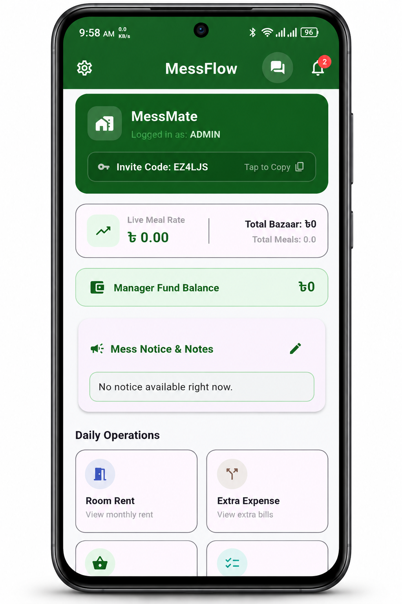
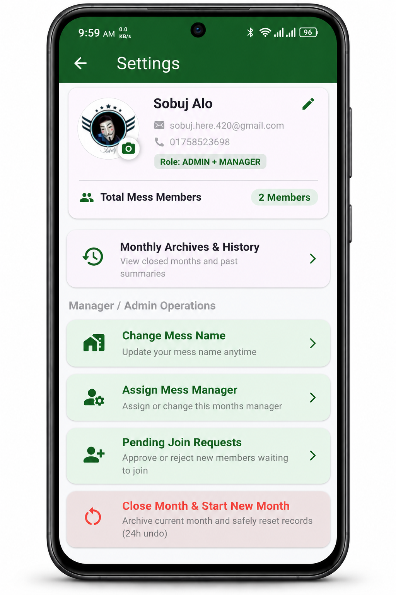
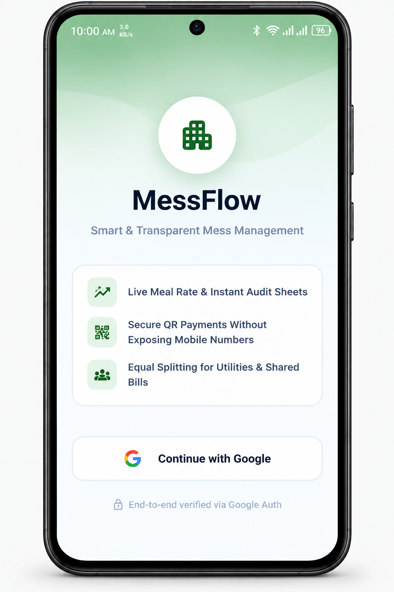
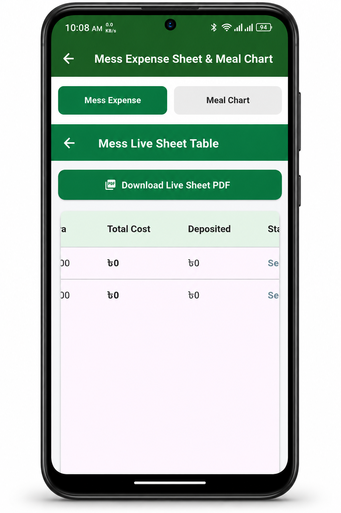

<p align="center">
  
</p>

<h1 align="center">🚀 MessFlow</h1>

<p align="center">
  <strong>Smart Mess & Hostel Management Application</strong>
</p>

<p align="center">
  <a href="https://flutter.dev"></a>
  <a href="https://dart.dev"></a>
  <a href="https://firebase.google.com"></a>
  <a href="https://github.com/sobuj-here/MessFlow/releases"></a>
  <a href="LICENSE"></a>
</p>

<p align="center">
  <em>An all-in-one digital solution for students and bachelor messes to track daily meals, manage bazaar expenses, automate meal rate calculations, persist room rents, handle utility bills, and archive monthly financial records with a 24-hour restore window.</em>
</p>

---

## 📥 Download MessFlow

Download the latest production release of **MessFlow** for Android:

<p align="center">
  <a href="https://github.com/sobuj-here/MessFlow/releases/download/v2.1.3/MessFlow-v2.1.2.apk">
    
  </a>
</p>

> [!NOTE]
> Download and install `MessFlow-v2.1.2.apk` directly to access the newest features, performance optimizations, and bug fixes.

---

## 📱 App Screenshots

<table>
  <tr>
    <td align="center">
      <b>🏠 Dashboard</b><br>
      
    </td>
    <td align="center">
      <b>⚙️ Settings & Admin</b><br>
      
    </td>
  </tr>
  <tr>
    <td align="center">
      <b>🔐 Login</b><br>
      
    </td>
    <td align="center">
      <b>📊 Expense & Meal Chart</b><br>
      
    </td>
  </tr>
</table>

---

## 🌟 Key Features & Modules

### 🏠 1. Live Mess Sheet & Real-Time Dashboard
- Real-time overview of **total bazaar costs, approved bazaar lists, total meals, and dynamic meal-rate calculations**.
- Dynamic meal rate recalculation engine: `(Total Approved Bazaar Cost) ÷ (Total Meals)`.
- Summary cards for monitoring overall mess financial status at a glance.

### 🍲 2. Daily Meal Management
- Seamless tracking of **breakfast, lunch, and dinner** for individual members.
- Full Day 1 to 31 matrix meal chart breakdown.
- Detailed monthly meal charts and daily meal-entry records with historical access.

### 🛒 3. Bazaar Management & Expense Adjustments
- **Duty Scheduling:** Manager can assign daily shopping duties to members with estimated budgets and checklists.
- **Negative Expense Adjustment:** Support for negative amounts (`-৳500`) when shopping money is saved, refunded, or returned.
- **Audit Badge & Alerts:** Any modified bazaar entry displays an `[EDITED]` badge and notifies members automatically.

### 🏢 4. Permanent Room Rent & Utility Bills Sheet
- **Permanent Rent Persistence:** Fixed room rent per member is saved permanently across months—no need to re-enter monthly.
- **Dynamic Status Badges:** Visual badges showing **Paid (Green)**, **Partial Due (Yellow)**, or **Unpaid (Red)**.
- **Shared Utility Bills Breakdown:** Itemized utility records for House Rent, Maid, Gas, WiFi, and Electricity.

### 💳 5. Payments, Funds & Anti-Duplicate Protection
- **Multi-Method Support:** Support for bKash, Nagad, Rocket, Upay, Bank Transfer, and Cash.
- **Double-Click Protection:** Debounce guards and database-level checks prevent accidental duplicate payments.
- **Automated Balances:** Clearly distinguishes between **Refunds and Dues** for each member.

### 🔒 6. Professional Month-End Fiscal Close (with 24-Hour Undo)
- **Executive Summary:** Clean metrics review for Bazaar, Total Meals, Meal Rate, and Utility Bills before finalizing.
- **24-Hour Safety Grace Window:** Any closed month can be restored back to the active state within 24 hours with a single click in Settings or History.
- **Secure Archive:** Securely archives completed months in Firebase Firestore with detailed tabular records.

### 🌐 7. Native Multi-Language Support
- Localized using `easy_localization` across **5 international languages**:
  - 🇺🇸 **English**
  - 🇧🇩 **বাংলা (Bengali)**
  - 🇮🇳 **हिन्दी (Hindi)**
  - 🇸🇦 **العربية (Arabic)**
  - 🇪🇸 **Español (Spanish)**
- Switch languages on-the-fly inside Settings with instantaneous full-app re-rendering.

### 🛡️ 8. Role-Based Access Control (RBAC) & Group Chat
- Secure administrative and managerial controls for authorized **Admins and Managers**.
- Protected operations include closing monthly records, resetting data, and managing member roles.
- Integrated group chat for roommates with instant system push notifications.

---

## 🛠️ Technology Stack

| Category | Technology |
|---|---|
| 📱 **Frontend Framework** | Flutter (Dart 3.5+) |
| 🔥 **Backend & Database** | Firebase Firestore (Offline Persistence Enabled) |
| 🔐 **Authentication** | Firebase Authentication (Email/Password & Google Sign-In) |
| ⚡ **State Management** | ValueNotifier & ListenableBuilder |
| 🌐 **Localization** | easy_localization (English, বাংলা, हिन्दी, العربية, Español) |
| 🔔 **Notifications** | Flutter Local Notifications with Custom Channels |
| ☁️ **Media Cloud** | Cloudinary API |

---

## 📂 Project Structure

```
lib/
├── controllers/          # State controllers (Theme, Language, App State)
├── screens/              # UI screens & dialogs
│   ├── home_screen.dart
│   ├── meal_screen.dart
│   ├── add_bazaar_screen.dart
│   ├── room_rent_sheet_screen.dart
│   ├── payment_screen.dart
│   ├── history_screen.dart
│   ├── settings_screen.dart
│   └── group_chat_screen.dart
├── services/             # Business logic & Firebase services
│   ├── auth_service.dart
│   ├── auto_notification_service.dart
│   └── permission_service.dart
├── translations/         # Localization JSON files (en, bn, hi, ar, es)
└── main.dart             # Application entrypoint
```

---

## 🚀 Setup & Installation

### 1. Prerequisites
- [Flutter SDK](https://docs.flutter.dev/get-started/install) (v3.24 or higher)
- [Android Studio](https://developer.android.com/studio) / VS Code
- Java 17 LTS

### 2. Clone the Repository
```bash
git clone https://github.com/sobuj-here/MessFlow.git
cd MessFlow
```

### 3. Firebase Configuration
For security reasons, private Firebase credentials are not tracked in this repository.
1. Create a project in the [Firebase Console](https://console.firebase.google.com/).
2. Enable **Firestore Database** and **Firebase Authentication**.
3. Copy `android/app/google-services.json.example` to `android/app/google-services.json` and replace the placeholder fields with your project credentials.

### 4. Install Dependencies & Run
```bash
flutter pub get
flutter run
```

### 5. Build Release APK
```bash
flutter build apk --release
```
The compiled APK will be generated at `build/app/outputs/flutter-apk/app-release.apk`.

---

## 📄 License

This project is licensed under the **MIT License** - see the [LICENSE](LICENSE) file for details.

---

<p align="center">
  Made with ❤️ for smart hostel and mess management.
</p>
